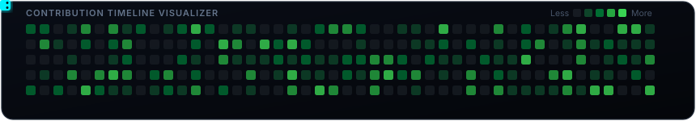

  <!-- ======================================================== -->
  <!-- HERO BANNER (ANIMATED CYBERTECH SVG)                    -->
  <!-- ======================================================== -->
  

  <!-- ======================================================== -->
  <!-- ANIMATED TYPEWRITER CAROUSEL                             -->
  <!-- ======================================================== -->
   
  

  <!-- ======================================================== -->
  <!-- CYBER PULSING DIVIDER                                    -->
  <!-- ======================================================== -->
  

  <!-- QUICK SOCIAL & BADGE BAR -->
  

    
    
    
    
  

 

<!-- ======================================================== -->
<!-- ABOUT ME & DUAL-COLUMN PROFILE MATRIX                    -->
<!-- ======================================================== -->

<table align="center" width="100%" style="border-collapse: collapse; border: none; background: transparent;">
  <tr style="border: none;">
    <!-- LEFT: ANIMATED AVATAR & QUICK STATUS -->
    <td width="32%" align="center" valign="middle" style="border: none; padding: 15px;">
      
        
      

        
         
        
         
        
      

    </td>
    <!-- RIGHT: EXECUTIVE SUMMARY & HIGHLIGHTS -->
    <td width="68%" valign="top" style="border: none; padding: 15px; color: #E2E8F0; font-family: -apple-system, BlinkMacSystemFont, 'Segoe UI', Roboto, sans-serif;">
      <h3 style="margin-top: 0; color: #00F2FE; display: flex; align-items: center; gap: 8px;">
        ⚡ Architecting High-Performance Systems &amp; AI Workflows
      </h3>
      

        Hey there! I am <b style="color: #F8FAFC;">Bhargav Ambati</b>, a full-stack engineer and tech builder passionate about crafting intelligent automation engines, decentralized protocols, and scalable digital solutions with seamless user experiences.
      

      <ul style="line-height: 1.8; color: #CBD5E1; font-size: 14px; padding-left: 20px;">
        <li>🚀 <b>Currently Building:</b> <a href="https://work-flow-x-ai-chi.vercel.app" target="_blank" style="color: #38BDF8; text-decoration: none;"><b>WorkFlowX-AI</b></a> — an autonomous AI orchestration engine transforming complex multi-step workflows.</li>
        <li>📊 <b>Graph &amp; Data Engineering:</b> Developing <a href="https://github.com/bhargavambati09-crypto/CLAIM-GRAPH" style="color: #A78BFA; text-decoration: none;"><b>CLAIM-GRAPH</b></a>, visualizing dynamic interconnected relationship nodes.</li>
        <li>🏥 <b>HealthTech Impact:</b> Engineered <a href="https://replit.com/@bhargavambati09/Holistic-Health-Tracker" target="_blank" style="color: #34D399; text-decoration: none;"><b>Holistic-Health-Tracker</b></a> (TypeScript) &amp; <a href="https://github.com/bhargavambati09-crypto/Aarogya" style="color: #34D399; text-decoration: none;"><b>Aarogya</b></a>.</li>
        <li>🌐 <b>Web3 &amp; Cryptography:</b> Exploring smart contract ecosystems, DeFi protocols, and decentralized security.</li>
        <li>💡 <b>Core Philosophy:</b> <i>"Code that is elegant, architectures that scale, and products that create real-world leverage."</i></li>
        <li>🎯 <b>Open To:</b> High-impact engineering roles, open-source collaborations &amp; AI/Web3 hackathons.</li>
      </ul>
    </td>
  </tr>
</table>

  

 

<!-- ======================================================== -->
<!-- SECTION: TELEMETRY & GITHUB PERFORMANCE METRICS          -->
<!-- ======================================================== -->

  

 

  <table width="100%" style="border-collapse: collapse; border: none; background: transparent;">
    <tr style="border: none;">
      <!-- GITHUB STATS CARD -->
      <td width="50%" align="center" valign="middle" style="border: none; padding: 6px;">
        
      </td>
      <!-- TOP LANGUAGES CARD -->
      <td width="50%" align="center" valign="middle" style="border: none; padding: 6px;">
        
      </td>
    </tr>
    <tr style="border: none;">
      <!-- STREAK STATS FULL WIDTH -->
      <td colspan="2" width="100%" align="center" valign="middle" style="border: none; padding: 6px;">
        
      </td>
    </tr>
  </table>

 

  

 

<!-- ======================================================== -->
<!-- SECTION: TECHNICAL ARSENAL & SKILLS                     -->
<!-- ======================================================== -->

  

 

  <!-- ROW 1: LANGUAGES & RUNTIMES -->
  

    <b>💻 Languages &amp; Core:</b> 
    
    
    
    
    
    
  

  <!-- ROW 2: FRONTEND & MODERN UI -->
  

    <b>⚛️ Frontend &amp; UI Architecture:</b> 
    
    
    
    
    
  

  <!-- ROW 3: AI, BACKEND & CLOUD -->
  

    <b>🤖 AI, Backend &amp; Cloud Infrastructure:</b> 
    
    
    
    
    
    
  

  <!-- ROW 4: WEB3, CRYPTO & WORKSPACE TOOLS -->
  

    <b>🌐 Web3, Crypto &amp; Developer Tools:</b> 
    
    
    
    
    
    
  

 

  

 

<!-- ======================================================== -->
<!-- SECTION: FEATURED CREATIONS & REPOSITORIES               -->
<!-- ======================================================== -->

  

 

<table width="100%" style="border-collapse: collapse; border: none; background: transparent;">
  <!-- ROW 1: WORKFLOWX-AI & CLAIM-GRAPH -->
  <tr style="border: none;">
    <td width="50%" valign="top" style="border: none; padding: 10px;">
      

        <h4 style="margin: 0; color: #00F2FE;">
          🚀 <a href="https://github.com/bhargavambati09-crypto/WorkFlowX-AI" style="color: #00F2FE; text-decoration: none;">WorkFlowX-AI</a>
        </h4>
        

          Next-generation AI-powered autonomous workflow automation engine. Connects complex business logic and agentic workflows into frictionless execution pipelines.
        

        

          
          
        

      

    </td>
    <td width="50%" valign="top" style="border: none; padding: 10px;">
      

        <h4 style="margin: 0; color: #9B51E0;">
          📊 <a href="https://github.com/bhargavambati09-crypto/CLAIM-GRAPH" style="color: #A78BFA; text-decoration: none;">CLAIM-GRAPH</a>
        </h4>
        

          High-performance interactive graph visualizer that models claim dependencies, relational networks, and knowledge structures with dynamic node rendering.
        

        

          
          
        

      

    </td>
  </tr>
  <!-- ROW 2: HOLISTIC-HEALTH-TRACKER & AAROGYA -->
  <tr style="border: none;">
    <td width="50%" valign="top" style="border: none; padding: 10px;">
      

        <h4 style="margin: 0; color: #00F5A0;">
          🏥 <a href="https://github.com/bhargavambati09-crypto/Holistic-Health-Tracker" style="color: #00F5A0; text-decoration: none;">Holistic-Health-Tracker</a>
        </h4>
        

          Comprehensive wellness monitoring platform providing real-time biometric metrics, user habit analytics, and data-driven holistic recommendations.
        

        

          
          
        

      

    </td>
    <td width="50%" valign="top" style="border: none; padding: 10px;">
      

        <h4 style="margin: 0; color: #38BDF8;">
          🌿 <a href="https://github.com/bhargavambati09-crypto/Aarogya" style="color: #38BDF8; text-decoration: none;">Aarogya Health Suite</a>
        </h4>
        

          Patient-centric healthcare management ecosystem tailored for quick diagnostics, medical record tracking, and vital signs monitoring.
        

        

          
          
        

      

    </td>
  </tr>
</table>

 

<!-- ======================================================== -->
<!-- INTERACTIVE SNAKE CONTRIBUTION GRAPH                    -->
<!-- ======================================================== -->

  
<b>🐍 Real-Time Contribution Grid Animation:</b>

  <!-- GitHub Action Dynamic Snake with Local SVG Fallback -->
  <picture>
    <source media="(prefers-color-scheme: dark)" srcset="https://raw.githubusercontent.com/bhargavambati09-crypto/bhargavambati09-crypto/output/github-contribution-grid-snake-dark.svg" />
    <source media="(prefers-color-scheme: light)" srcset="https://raw.githubusercontent.com/bhargavambati09-crypto/bhargavambati09-crypto/output/github-contribution-grid-snake.svg" />
    
  </picture>

 

  

 

<!-- ======================================================== -->
<!-- SECTION: TRANSMISSION & CONNECTIVITY                     -->
<!-- ======================================================== -->

  

 

  

    I'm always excited to collaborate on bold ideas, AI breakthroughs, Web3 products, or open-source initiatives!
  

  

    
    
    
    
    
  

   

  <!-- PHILOSOPHY / INSPIRATION -->
  

    <i>"Any fool can write code that a computer can understand. Good programmers write code that humans can understand."</i>
     
    — MARTIN FOWLER
  

    
  

  

    ⚡ CRAFTED WITH OBSESSIVE CARE FOR <b>BHARGAV AMBATI</b> • KEEP BUILDING &amp; SHIPPING ⚡
  

